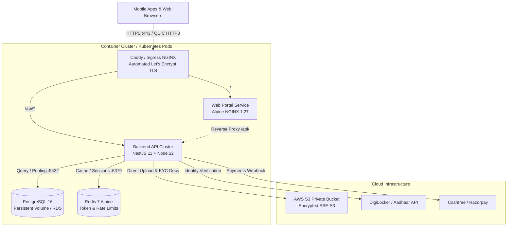

# Safar Self Drive — Enterprise DevOps & Deployment Guide

> **Production-grade containerization, orchestration, and CI/CD architecture for Safar Self Drive.**

---

## 1. System Architecture



---

## 2. Directory Structure

```text
├── apps/
│   ├── backend/
│   │   ├── Dockerfile                  # Production Multi-stage NestJS + Python Dockerfile
│   │   ├── docker-entrypoint.sh        # Container init, signal trap & auto-migration
│   │   ├── .dockerignore               # Optimized build context exclusions
│   │   └── requirements.txt            # Python docx & reportlab dependencies
│   ├── web/
│   │   ├── Dockerfile                  # Alpine Nginx container serving static portal
│   │   ├── nginx.conf                  # Gzip, caching headers & reverse proxy rules
│   │   └── .dockerignore
│   └── mobile/                         # Expo React Native client (EAS Build / App Stores)
├── k8s/                                # Kubernetes Production Manifests
│   ├── namespace.yaml                  # safar-production namespace
│   ├── configmap.yaml                  # App config & environment parameters
│   ├── secrets.template.yaml           # Secrets template (JWT, DB, S3, Sandbox)
│   ├── backend-deployment.yaml         # NestJS 2+ replicas, HPA, Probes
│   ├── web-deployment.yaml             # Nginx frontend replicas
│   ├── migration-job.yaml              # Pre-deployment Prisma DB migration Job
│   ├── ingress.yaml                    # Ingress with Cert-Manager TLS
│   └── kustomization.yaml              # Kustomize manifest bundle
├── .github/workflows/
│   ├── ci.yml                          # PR validation, lint, build check & dry-run
│   └── deploy.yml                      # Multi-arch Buildx, GHCR push & SSH zero-downtime deploy
├── scripts/devops/
│   ├── deploy.sh                       # Single-host production deployment script
│   └── backup-db.sh                    # Automated PostgreSQL snapshot & 14-day pruning
├── docker-compose.yml                  # Local full-stack development orchestration
├── docker-compose.prod.yml             # Production multi-container stack with resource limits
├── Caddyfile                           # Edge proxy with automated Let's Encrypt TLS & HTTP/3
├── .env.production.example             # Complete production environment reference
└── DEVOPS.md                           # This operations manual
```

---

## 3. Container Optimization & Security Features

### Backend (`apps/backend/Dockerfile`)
1. **Multi-Stage Build Pipeline**:
   - `base`: Minimal Node 22-slim with system libraries (`curl`, `dumb-init`, `openssl`).
   - `builder`: Compiles NestJS and native dependencies (`sharp`, `better-sqlite3`), prepares PostgreSQL Prisma client (`prepare-postgres.js`), and runs `npm prune --omit=dev`.
   - `runner`: Contains only production dependencies, compiled `dist`, isolated Python virtual environment (`/opt/venv`), and static templates.
2. **PID 1 Signal Handling**: Uses `/usr/bin/dumb-init` to properly trap `SIGTERM`/`SIGINT` signals, ensuring zero zombie processes and clean socket termination during rolling updates.
3. **Non-Root Execution**: Runs as unprivileged system user `node:node` (`UID 1000`), preventing container breakout vulnerabilities.
4. **Automated Health Probes**: Native container `HEALTHCHECK` pinging `http://localhost:3000/api/health`.

### Web Frontend (`apps/web/Dockerfile`)
1. **Lightweight Base**: Runs on `nginx:1.27-alpine` (~25MB total footprint).
2. **Dynamic Compression**: Gzip compression enabled for JS, CSS, JSON, SVG, and HTML.
3. **Asset Caching**:
   - `Cache-Control: public, max-age=2592000, immutable` for static images, logos, and fonts.
   - `Cache-Control: public, max-age=604800` for bundled CSS and JS.
   - `no-cache, must-revalidate` for HTML to guarantee instant client updates on deploy.
4. **Built-in Security Headers**: Pre-configured `X-Frame-Options`, `X-Content-Type-Options`, and `Referrer-Policy`.

---

## 4. Local Development Deployment

Run the complete multi-tier stack locally (Postgres + Redis + API + Web) with one command:

```bash
# Clone the repository
git clone https://github.com/Devendra-001/ZipTrip.git
cd ZipTrip

# Start all containers in detached mode
docker compose up -d --build

# Inspect running containers
docker compose ps

# Follow backend application logs
docker compose logs -f backend
```

- Web Portal: `http://localhost:8080`
- Backend API: `http://localhost:3000/api/health`
- PostgreSQL: `localhost:5432` (User: `safar_user`, DB: `safar_db`)
- Redis: `localhost:6379`

---

## 5. Production Single-Server Deployment (EC2 / VPS)

For a single dedicated cloud VM (e.g. AWS EC2 `t3.large` or `c6i.large`, Ubuntu 24.04):

### Step 1: Install Docker & Docker Compose
```bash
sudo apt-get update
sudo apt-get install -y ca-certificates curl gnupg
sudo install -m 0755 -d /etc/apt/keyrings
curl -fsSL https://download.docker.com/linux/ubuntu/gpg | sudo gpg --dearmor -o /etc/apt/keyrings/docker.gpg
sudo chmod a+r /etc/apt/keyrings/docker.gpg
echo "deb [arch=$(dpkg --print-architecture) signed-by=/etc/apt/keyrings/docker.gpg] https://download.docker.com/linux/ubuntu $(. /etc/os-release && echo "$VERSION_CODENAME") stable" | sudo tee /etc/apt/sources.list.d/docker.list > /dev/null
sudo apt-get update
sudo apt-get install -y docker-ce docker-ce-cli containerd.io docker-buildx-plugin docker-compose-plugin
sudo usermod -aG docker $USER
```

### Step 2: Configure Environment Secrets
```bash
cd /opt
sudo git clone https://github.com/Devendra-001/ZipTrip.git safar-selfdrive
cd safar-selfdrive

# Create production environment file
cp .env.production.example .env.production
nano .env.production
```
*Fill in `POSTGRES_PASSWORD`, `JWT_SECRET` (generate with `openssl rand -hex 32`), `DOMAIN`, and payment/storage keys.*

### Step 3: Launch Production Stack
```bash
# Execute deployment script
chmod +x scripts/devops/deploy.sh scripts/devops/backup-db.sh
./scripts/devops/deploy.sh
```

Caddy will automatically contact Let's Encrypt, issue SSL certificates for `safarselfdrive.com`, and enforce HTTPS.

---

## 6. Enterprise Kubernetes Deployment (EKS / GKE / K3s)

For high-availability clustered deployments:

### Step 1: Apply Namespace & Secrets
```bash
kubectl apply -f k8s/namespace.yaml

# Copy and populate secrets
cp k8s/secrets.template.yaml k8s/secrets.yaml
# (Edit k8s/secrets.yaml with base64/plaintext credentials)
kubectl apply -f k8s/secrets.yaml
kubectl apply -f k8s/configmap.yaml
```

### Step 2: Run Database Migration Job
```bash
kubectl apply -f k8s/migration-job.yaml
kubectl wait --for=condition=complete --timeout=120s job/safar-db-migration -n safar-production
```

### Step 3: Deploy Applications & Ingress
```bash
kubectl apply -f k8s/backend-deployment.yaml
kubectl apply -f k8s/web-deployment.yaml
kubectl apply -f k8s/ingress.yaml

# Check rollout status
kubectl rollout status deployment/safar-backend -n safar-production
kubectl rollout status deployment/safar-web -n safar-production
```

---

## 7. CI/CD Automation (GitHub Actions)

The repository includes two GitHub Actions pipelines:

1. **`.github/workflows/ci.yml`**:
   - Triggers on every Pull Request.
   - Runs TypeScript validation, Prisma client generation, and build tests.
   - Performs a Docker Buildx dry-run to ensure container layers build cleanly.

2. **`.github/workflows/deploy.yml`**:
   - Triggers on push to `main`.
   - Builds multi-arch container images (`ghcr.io/<repo>/backend:latest` and `ghcr.io/<repo>/web:latest`).
   - Uses GitHub Actions layer caching (`type=gha`) for ultra-fast incremental builds.
   - Executes zero-downtime rolling restart on production servers via SSH.

### Required GitHub Repository Secrets
Under **Settings -> Secrets and variables -> Actions**:
- `PROD_SERVER_HOST`: Public IP or DNS of production server (e.g. `65.0.61.233`).
- `PROD_SERVER_USER`: SSH user (e.g. `ubuntu`).
- `PROD_SERVER_SSH_KEY`: Private SSH Key for automated deployment.

---

## 8. Database Backup & Disaster Recovery

### Automatic Backups
Add a crontab entry for daily automated backups at 03:00 AM:
```bash
0 3 * * * /opt/safar-selfdrive/scripts/devops/backup-db.sh >> /var/log/safar-backup.log 2>&1
```

### Manual Backup
```bash
./scripts/devops/backup-db.sh
```

### Database Restore Procedure
```bash
# Decompress and restore into PostgreSQL container
gunzip -c /opt/safar-backups/safar_db_YYYYMMDD_HHMMSS.sql.gz | docker exec -i safar-prod-postgres psql -U safar_admin -d safar_production
```

---

## 9. Production Maintenance Quick Reference

| Action | Command |
| :--- | :--- |
| **View Service Status** | `docker compose -f docker-compose.prod.yml ps` |
| **Live API Logs** | `docker compose -f docker-compose.prod.yml logs -f backend` |
| **Live Proxy Logs** | `docker compose -f docker-compose.prod.yml logs -f gateway` |
| **Restart Backend Gracefully** | `docker compose -f docker-compose.prod.yml restart backend` |
| **Run Prisma Migration** | `docker exec -it safar-prod-backend npx prisma migrate deploy --config prisma.postgres.config.ts` |
| **Create Super Admin** | `docker exec -it safar-prod-backend node scripts/create-admin.js --email admin@safarselfdrive.com` |
| **Check API Health** | `curl -i http://localhost:3000/api/health` |
| **Check Web Health** | `curl -i http://localhost/healthz` |
| **Clean Docker System** | `docker system prune -a --volumes -f` |
